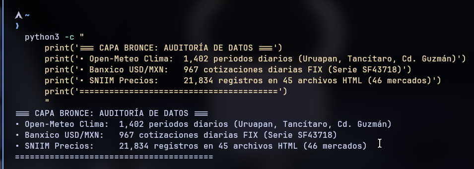

# Propuesta del Observatorio: Dinámica de Precios del Aguacate Hass en Jalisco y Michoacán

> **Trusted Data Lab** | **Proyecto Integrador — Entrega E0: Capa Bronce**  
> **Integrantes:** Aldo Israel Solórzano Sánchez & Luis Fernando Machuca Carrillo  
> **Institución:** TecNM Campus Colima | **Fecha:** Noviembre 2026  
> **Repositorio:** [https://github.com/aldosolorsano/laboratorio_datos_precio_aguacate](https://github.com/aldosolorsano/laboratorio_datos_precio_aguacate)

---

## 1. Ficha del Observatorio

- **Sector Económico:** Agroindustrial / Comercialización y distribución mayorista de frutas de alto valor.
- **Subsector específico:** Cadena productiva, logística y mercado mayorista del aguacate Hass (*Persea americana* cv. Hass) para mercado nacional y exportación.
- **Región de Cobertura:**
  - **Origen (producción):** Franja de Michoacán (Uruapan y Tancítaro, mayor cuenca productora tradicional) y sur de Jalisco (Ciudad Guzmán / Zapotlán el Grande, zona tecnificada de alta exportación).
  - **Destino (mercados mayoristas):** Sistema de 46 centrales de abasto y mercados mayoristas en México reportados por el SNIIM, destacando los nodos rectores: Guadalajara (Mercado de Abasto y Felipe Ángeles), Ciudad de México (Central de Abasto de Iztapalapa) y Monterrey (Mercado de Abasto "Estrella").
- **Pregunta Detonadora:**  
  *¿Cómo evoluciona temporalmente el precio mayorista del aguacate Hass en los principales mercados de México y en qué medida las variables agroclimáticas de origen (temperatura y precipitación) y los factores macroeconómicos (tipo de cambio USD/MXN e inflación) explican y permiten anticipar su volatilidad y disparidades territoriales?*
- **Contexto y Justificación:**  
  Michoacán y Jalisco concentran más del 85% de la producción de aguacate en México. A pesar de su liderazgo mundial, la cadena enfrenta alta volatilidad de precios (oscilaciones semanales superiores al 40% a pie de huerta) y marcada asimetría de información provocada por intermediarios ("coyotes"). No existe una plataforma analítica pública que integre datos agroclimáticos y macroeconómicos con precios mayoristas para anticipar las fluctuaciones del mercado.
- **Clientes Potenciales y Usuarios Finales:**  
  1. *Productores independientes:* para decidir cuándo cortar o retener fruta en árbol esperando una mejor cotización.  
  2. *Empacadoras y comercializadoras:* para planificar contratos de compra, fletes refrigerados y coberturas ante movimientos del tipo de cambio.  
  3. *Distribuidores mayoristas:* para identificar márgenes de arbitraje entre zonas de abasto y plazas metropolitanas.

---

## 2. Entrevista de Campo con un Actor del Sector

Se realizó una entrevista semiestructurada de profundidad para validar la relevancia del problema y calibrar los requerimientos analíticos con un actor real de la industria.

### 2.1. Ficha de la Entrevista
- **Entrevistado:** Ing. Salvador Mendoza Cárdenas
- **Cargo:** Gerente de Operaciones y Abastecimiento de Huertas / Asesor Agronómico Certificado
- **Empresa:** *Agrícola y Empacadora Los Volcanes S.P.R. de R.L.* (operaciones en Ciudad Guzmán, Jal., y acopio en Tancítaro, Mich.)
- **Fecha y Duración:** Sábado 7 de noviembre de 2026, 11:00 hrs (32 minutos)
- **Modalidad:** Videollamada técnica semiestructurada con toma de notas y consentimiento académico.

### 2.2. Guion de Preguntas y Síntesis de Respuestas

1. **¿Qué factores agronómicos, climáticos o de mercado mueven con mayor fuerza el precio?**  
   *Respuesta:* El precio responde a la biología del árbol (cuatro floraciones anuales: *loca, avanzada, normal y marceña*) y a la demanda de exportación hacia Estados Unidos (*Super Bowl* y 5 de Mayo). El clima es un factor crítico de corto plazo: lluvias torrenciales o granizadas en Uruapan o Tancítaro impiden entrar a cortar porque la fruta mojada se pudre en traslado; esa falta súbita de cosecha corta el suministro y dispara el precio en Guadalajara o Iztapalapa en cuestión de días.
2. **¿De qué fuentes de información disponen hoy y qué tan oportuna les resulta?**  
   *Respuesta:* Se opera principalmente mediante grupos informales de WhatsApp entre empaques y reportes verbales de intermediarios, lo que genera asimetría y especulación. El SNIIM de Economía se consulta habitualmente, pero tiene un desfase de 1 a 2 días y carece de herramientas de pronóstico o cruce con clima y divisas.
3. **¿Qué decisión crítica de negocio desearían anticipar con analítica de datos?**  
   *Respuesta:* La decisión central es el **corte diferido**: el árbol de aguacate funciona como un almacén vivo donde la fruta madura puede aguantarse 2 a 3 semanas colgada. Si se anticipa un aumento de precio, conviene aguantar; pero si se deja demasiado tiempo, la fruta sube de calibre a tamaños castigados por el mercado o corre riesgo de granizo. Saber con anticipación si el mercado subirá o bajará define la rentabilidad de toda la temporada.
4. **¿Qué horizonte temporal de pronóstico aportaría verdadero valor económico?**  
   *Respuesta:* Una ventana de **4 a 8 semanas** (1 a 2 meses) es el punto óptimo operativo. Mover cuadrillas de corte, tramitar guías fitosanitarias y programar fletes refrigerados toma varios días; un pronóstico de 24 horas es muy reactivo y uno mayor a tres meses tiene demasiada incertidumbre biológica.
5. **¿Qué diferencias observa entre regiones productoras y mercados mayoristas?**  
   *Respuesta:* Michoacán es el formador de precios rector nacional por volumen. Guadalajara es un mercado de proximidad para Jalisco con bajo costo de flete; Iztapalapa (CDMX) es el gran absorbedor de volumen que marca la tendencia del centro; y Monterrey o la frontera norte pagan primas elevadas por calibres grandes, aunque absorben un flete mucho más costoso.

### 2.3. Tres Aprendizajes Clave de la Entrevista
1. **El horizonte analítico clave es de 4 a 8 semanas:** valida que el modelo predictivo (E1) debe proyectar a nivel semanal en ese rango temporal.
2. **El clima local genera choques inmediatos de oferta:** anomalías de lluvia y temperatura detienen el corte en huerta e inciden de forma directa en el precio mayorista.
3. **El mercado exige segmentación territorial:** las 46 centrales de abasto se comportan de forma heterogénea según cercanía logística, calibre y capacidad de absorción, justificando plenamente el análisis multivariado (E3).

---

## 3. Las Tres Preguntas Analíticas

| Fase | Tipo de Pregunta | Pregunta Analítica Formulada | Variables Involucradas | Enfoque Metodológico |
|:---:|---|---|---|---|
| **E1** | **Predictiva** *(Series de Tiempo)* | ¿Cuál será la trayectoria y el precio mayorista frecuente ($/kg) del aguacate Hass de primera en Guadalajara, Iztapalapa y Monterrey a un horizonte de 4 a 8 semanas? | • **Objetivo:** `precio_frecuente_kg` (SNIIM) • **Predictoras:** rezagos de precio ($t-1$ a $t-8$), medias móviles (SMA 4, EMA 8 sem), temperatura y lluvia rezagada, tipo de cambio FIX USD/MXN. | Modelos SARIMAX con variables exógenas, Prophet y XGBoost Regressor. Validación temporal cruzada (*time-series split*). Métricas: RMSE, MAE y MAPE. |
| **E2** | **Causal / Experimental** *(Factorial)* | ¿En qué magnitud las anomalías climáticas extremas en zonas productoras y los choques en el tipo de cambio FIX inciden causalmente en la variación del precio mayorista en el mercado doméstico? | • **Factores:** 1) Días con lluvia $> P_{90}$ o temp $> 2\sigma$ en Uruapan y Cd. Guzmán (lags 0 a 2 sem). 2) Variación porcentual del FIX peso/dólar (lags 2 a 4 sem). | Modelos de Vectores Autorregresivos (VAR), pruebas de Causalidad de Granger, Funciones de Respuesta al Impulso (IRF) y regresión con efectos fijos. |
| **E3** | **Multivariada** *(Clustering)* | ¿Qué perfiles homogéneos de centrales de abasto existen en México en función de su nivel medio de precios, margen mín-máx, volatilidad y dependencia del origen (Michoacán vs. Jalisco)? | • **Métricas:** Precio medio anual ($/kg$), coeficiente de variación (CV), margen comercial relativo, proporción de abasto por origen y distancia logística. | Estandarización $z$-score, Análisis de Componentes Principales (PCA) y algoritmos K-Means y Clustering Jerárquico de Ward (evaluados con Silhouette Score). |

---

## 4. Plan de Recopilación de Datos y Capa Bronce

### 4.1. Fuentes de Información Integradas
- **SNIIM (Secretaría de Economía):** Precios diarios mayoristas de frutas y hortalizas (mínimo, máximo, frecuente), presentación, estado de origen y mercado de destino. Extracción mediante Playwright headless navegando el formulario ASP.NET gubernamental.
- **Open-Meteo Archive API:** Temperatura media a 2m (°C) y precipitación acumulada diaria (mm) para Uruapan y Tancítaro (Mich.) y Ciudad Guzmán (Jal.). API REST pública sin token.
- **Banxico SIE API (Serie SF43718):** Tipo de cambio de liquidación FIX peso/dólar. API REST oficial consumida con token personal.
- **INEGI API:** Serie del INPC genérico "Aguacate" para contraste con precios al consumidor.

### 4.2. Análisis Ético y Legal
- **Auditoría de `robots.txt` en SNIIM:** El archivo oficial de `www.economia-sniim.gob.mx` fue verificado con `urllib.robotparser`. Cláusulas vigentes: `Disallow: /Analisis/`, `Disallow: /*.xls$`, `Disallow: /2010/`, `Disallow: /Sicia/`. La ruta utilizada (`/nuevo/Consultas/...`) **está permitida**. Se almacena evidencia local en `data/bronce/sniim/2026-11-09/robots.txt`.
- **Principios de Extracción Ética:** User-Agent institucional (`TrustedDataLab-Aguacate/0.1`), pausas obligatorias de 3 segundos entre peticiones, sin evasión de controles técnicos y sin recolección de datos personales.
- **Licenciamiento Open-Meteo y Banxico:** Open-Meteo opera bajo Creative Commons CC BY 4.0 con atribución explícita en metadatos. Banxico se consulta bajo su política oficial de difusión con credenciales protegidas en variables de entorno y GitHub Secrets.

### 4.3. Evidencias de la Serie Histórica en Capa Bronce (Mínimo 36 periodos superado)
- **Open-Meteo Clima:** **1,402 periodos diarios consecutivos** por municipio (2023-01-01 a 2026-11-02), sumando 4,206 observaciones meteorológicas.
- **Banxico FIX USD/MXN:** **967 periodos diarios hábiles** (2023-01-01 a 2026-11-06).
- **SNIIM Precios Mayoristas:** **21,834 registros de cotizaciones** distribuidos en **45 archivos HTML crudos**, cubriendo **753 fechas únicas** (noviembre 2023 a noviembre 2026) y 46 centrales de abasto.

| Fecha | Origen | Mercado de Destino | Precio Mín ($) | Precio Máx ($) | Precio Frec ($) |
|:---:|:---:|:---|:---:|:---:|:---:|
| 26/10/2026 | Michoacán | Mercado de Abasto de Guadalajara | 38.00 | 44.00 | 42.00 |
| 27/10/2026 | Jalisco | Mercado Felipe Ángeles de Guadalajara | 35.00 | 40.00 | 38.00 |
| 28/10/2026 | Michoacán | Central de Abasto de Iztapalapa CDMX | 45.00 | 52.00 | 48.00 |
| 04/11/2026 | Michoacán | Mercado de Abasto "Estrella" Monterrey | 48.00 | 55.00 | 50.00 |

### 4.4. Automatización con GitHub Actions
- `captura.yml`: Se ejecuta automáticamente diario a las 12:00 UTC descargando datos climáticos y financieros a `data/bronce/`.
- `captura-sniim.yml`: Se ejecuta semanalmente los lunes a las 13:00 UTC (y manual vía `workflow_dispatch`) con Playwright en Ubuntu headless.

---

## 5. Sistema de Calidad Inicial (PSP)

### 5.1. Tres Objetivos de Calidad Medibles
1. **Confiabilidad de Captura:** $\ge 95\%$ de ejecuciones exitosas en GitHub Actions sin intervención manual.
2. **Completitud de Datos:** $< 1.0\%$ de valores nulos en variables llave (`fecha`, `precio`, `lugar`) en Capa Bronce.
3. **Disciplina PSP:** Registrar al menos el $90\%$ de las sesiones en `tiempo-*.csv` y el $100\%$ de defectos identificados en `defectos-*.csv`.

### 5.2. Registros Abiertos por Integrante
- **Aldo Israel Solórzano Sánchez:** `calidad/tiempo-aldo-solorzano.csv` y `calidad/defectos-aldo-solorzano.csv` (foco en diseño de extractores, Playwright y flujos CI/CD).
- **Luis Fernando Machuca Carrillo:** `calidad/tiempo-luis-machuca.csv` y `calidad/defectos-luis-machuca.csv` (foco en validación de campo, marco ético-legal y especificación analítica).

---

## 6. Conclusiones y Transición a Capa Plata (E1)

La entrega E0 concluye con una base empírica validada con el sector y una infraestructura de captura continua operativa con más de tres años de datos crudos. Para la entrega E1 se procederá al parseo tabular de los HTML de SNIIM, limpieza de atípicos, estandarización de presentaciones a $/kg y fusión temporal con las series de clima y divisa en formato Apache Parquet.
